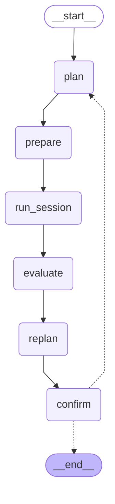

# lumi-wellness-agent-be

LUMI(Light + Mind)의 백엔드입니다. LUMI는 심리학 이론·임상/실험 연구 Reference 기반 AI 웰니스 에이전트로,
사용자 상태에 맞는 자연 이미지·소리 회복 세션을 추천하고 추천 근거를 Reference 카드로 보여 줍니다.
FastAPI, Supabase Postgres(pgvector), LangGraph·LangChain을 사용합니다. 프론트엔드는
[lumi-wellness-agent-fe](https://github.com/lumi-wellness-agent/lumi-wellness-agent-fe)에서 개발합니다.

현재는 실행·검증 환경, 연구 근거 DB의 첫 마이그레이션, 에이전트 그래프의 골격을 만든 단계입니다.
그래프의 배선과 흐름(계획 → 실행 대기 → 평가 → 재계획 루프)은 테스트로 확인했고, 노드의 실제 일
(근거 검색·검증, 콘텐츠 생성, 평가 기준)과 세션 API는 아직 구현하지 않았습니다.

## 구조

### Offline: 연구 근거 구축 (`app/ingestion/`)

```text
collect.py   논문 수집 — OpenAlex · Europe PMC
parse.py     원문 파싱 — Docling(PDF) · JATS XML
extract.py   실험 단위 Evidence Record + 메타데이터 → evidence_records 테이블
```

### Online: LUMI Care Agent (`app/agent/`)

에이전트 아키텍처를 LangGraph 그래프 하나로 옮겼습니다. `make graph`가 아래 다이어그램을 출력합니다.



| 노드 | 아키텍처 | 하는 일 | 파일 |
| --- | --- | --- | --- |
| `plan` | ① Adaptive Care Planning Agent | RAG 근거 검색 + Protocol DB 검증으로 활동 선택·조합 적합성·실행 순서를 정해 `CarePlan`(단일 · 동시 복합 · 순차 복합)을 만든다 | `nodes/planner.py` |
| `prepare` | ② Care Session Executor | 활동별 콘텐츠(자연 사진·AI 이미지·안내 문구·Reference 카드)를 준비한다 | `nodes/executor.py` |
| `run_session` ⏸ | ② Care Session Executor | FE 플레이어가 멀티모달 활동을 실행하고 사후 측정(`SessionReport`)을 보낼 때까지 기다린다 | `nodes/executor.py` |
| `evaluate` | ③ Outcome Evaluator | 목표별 개선 정도를 잰다 (지금은 스트레스 수준의 사전·사후 차이) | `nodes/evaluator.py` |
| `replan` | ④ Replanning | 종료 · 활동 변경 · 추가 세션 중 하나를 제안한다 (지금은 임시 규칙) | `nodes/replanner.py` |
| `confirm` ⏸ | ④ Replanning | 사용자 선택·동의(`ReplanDecision`)를 기다린다. 활동 변경·추가 세션이면 `plan`으로 돌아간다 | `nodes/replanner.py` |

⏸는 LangGraph interrupt입니다. 그래프가 멈추고 상태를 체크포인터에 남긴 뒤, 같은 thread_id로
`Command(resume=값)`을 받으면 그 자리부터 이어서 돕니다. interrupt가 있는 노드는 재개될 때 처음부터
다시 실행되므로, 콘텐츠 생성처럼 비용이 드는 일은 앞 노드(`prepare`)에서 끝내 state에 남깁니다.

| 세션 | 원하는 변화 | 중심 중재 |
| --- | --- | --- |
| S1 반복적 생각 완화 | 반복적으로 떠오르는 생각에서 잠시 벗어나기 | 이미지 + 짧은 마음챙김 / 디지털 컬러링(실험) |
| S2 스트레스·긴장 완화 | 스트레스와 긴장감 완화 | 이미지 + 호흡 훈련 / PMR |
| S3 주의력·인지 피로 회복 | 인지 피로 이후 주의력 회복 | 자연 보행 / 자연 사진 |

공통 원칙

- 논문 RAG는 근거 검색에 쓰고, 세션 실행은 검수된 프로토콜만 씁니다.
- AI 생성 이미지는 보조 콘텐츠로 쓰고, 결합한 세션(동시·순차 복합)의 통합 효과는 별도 실험으로 검증합니다.
- 의료적 진단·치료 효능을 주장하지 않습니다.

### LangGraph·LangChain을 쓰는 곳

- **LangGraph — 세션 그래프 전체.** Replanning → Planner 순환, 사용자 선택에 따른 분기, 사용자가
  활동을 마치거나 동의할 때까지 멈췄다가 이어 가는 interrupt가 필요합니다. 상태가 체크포인터에 남아
  HTTP 요청이 나뉘어도 세션이 이어집니다.
- **LangChain — Planner 하나.** `create_agent`가 LLM에 Tool(`search_evidence`, `validate_evidence`,
  `get_care_protocols`)을 골라 부르게 하고, `CarePlan`을 구조화 출력(`ToolStrategy`)으로 받습니다.
  받은 계획은 `check_plan`이 후검증하고, 어기면 거부 사유를 붙여 한 번 다시 묻습니다.
- **나머지는 일반 Python입니다.** 논문 수집·검색(psycopg), Outcome Evaluator, Replanning 규칙에는
  LangChain을 쓰지 않습니다.

근거 메타데이터(`app/schemas/evidence.py`)는 기획서 8.1의 필드에 '논문 수집 방식'의
`intervention_order`·`duration`·`evidence_role`을 더한 초안입니다. 두 자료에서 뜻이 다른 `modality`를
어떻게 나눴는지는 모듈 docstring에 적었습니다.

### 세션 API (설계안, 미구현)

세션 하나가 LangGraph thread 하나입니다. FE는 interrupt마다 응답을 받고, 다음 요청으로 재개합니다.

| 요청 | 그래프 | 응답 |
| --- | --- | --- |
| `POST /sessions` — `CareRequest` | 새 thread → plan → prepare → `run_session`에서 멈춤 | 계획·콘텐츠 |
| `POST /sessions/{id}/report` — `SessionReport` | 재개 → evaluate → replan → `confirm`에서 멈춤 | 평가·제안 |
| `POST /sessions/{id}/decision` — `ReplanDecision` | 재개 → 종료, 또는 plan → prepare → `run_session`에서 멈춤 | 종료 요약 또는 새 계획·콘텐츠 |

체크포인터는 지금 `InMemorySaver`(`app/agent/checkpoint.py`)라 서버를 다시 띄우면 진행 중인 세션이
사라집니다. 운영 전에 `langgraph-checkpoint-postgres`로 바꿔 Supabase에 저장하고, 체크포인트 테이블은
Data API에 노출되지 않는 스키마에 둡니다.

## 시작하기

Python 3.12 이상이 필요합니다.

```bash
python3 -m venv .venv
.venv/bin/pip install -e ".[dev]"
cp .env.example .env    # DATABASE_URL 채우기 (비워 두면 DB 없이 뜬다)
make run                # http://127.0.0.1:8000/health
```

| 명령 | 하는 일 |
| --- | --- |
| `make run` | 개발 서버 (코드 변경 시 자동 재시작) |
| `make lint` | ruff 검사 |
| `make test` | pytest (그래프 흐름과 Planner 배선은 대본 모델로 확인해 LLM을 부르지 않는다) |
| `make graph` | 세션 그래프를 Mermaid로 출력 |

## 데이터베이스 (Supabase)

1. Supabase 프로젝트에 `supabase/migrations/20261021000000_init_evidence.sql`을 적용합니다.
   대시보드 SQL Editor에 붙여 실행하거나 `psql "$DATABASE_URL" -f <파일>`로 실행합니다.
2. 대시보드의 **Connect** 창에서 연결 문자열을 복사해 `.env`의 `DATABASE_URL`에 넣습니다.
3. `make run` 후 `GET /health/db`로 연결과 확장(pgvector·pg_trgm) 설치를 확인합니다.

| 연결 방식 | 포트 | 네트워크 | 쓰는 곳 |
| --- | --- | --- | --- |
| Direct connection | 5432 | IPv6 (IPv4 add-on이 없을 때) | 상주 서버(VM·컨테이너) |
| Shared pooler — session mode | 5432 | IPv4 | 로컬 개발, IPv4 네트워크의 상주 서버 |
| Shared pooler — transaction mode | 6543 | IPv4 | 서버리스 함수 |

트랜잭션 모드는 prepared statement를 지원하지 않습니다. `app/db.py`가 psycopg의 자동 prepare를 꺼 두어
세 방식 모두 같은 코드로 동작합니다.

| 테이블 | 내용 |
| --- | --- |
| `papers` | 논문 한 편. `id`는 근거 재분류 시트의 ID(P01…, N01…), DOI가 없으면 `url`로 원문을 가리킨다 |
| `evidence_records` | 실험 단위 Evidence Record. 원문 구간(`content`), 메타데이터(`metadata` jsonb), 임베딩(`vector(1536)`) |

`public` 스키마의 테이블은 Data API로 노출되므로 RLS를 켜고 정책은 두지 않았습니다. publishable 키로는
읽고 쓸 수 없고, 테이블 소유자인 `postgres` 역할로 접속하는 백엔드에는 영향이 없습니다.

## 브랜치·PR 규칙

feature → `main`으로 올립니다. 인프라가 Supabase 하나라 `dev`를 따로 두어도 같은 DB를 써서
환경이 나뉘지 않기 때문입니다. 스테이징 환경(별도 Supabase 프로젝트 등)과 배포 파이프라인이 생기면
그때 `dev`를 추가합니다.

1. 이슈를 템플릿(기능 구현 · 기능 수정 · 오류 수정 · 리팩토링 · 문서 작업 · 기타 수정)으로 만듭니다.
2. `main`에서 `<타입>/#<이슈 번호>` 브랜치를 만듭니다. 예: `feat/#12`, `chore/#13`
3. `main`으로 PR을 올립니다. 제목은 `[타입/#이슈 번호] 설명`이고 본문에 `close #이슈 번호`를 적습니다.
   CI(`check`: ruff·pytest, `gitleaks`)를 통과해야 머지할 수 있고, squash merge합니다.

`main`은 PR 필수(승인 0명), 필수 체크 `check`·`gitleaks`, 강제 푸시·삭제 금지로 보호합니다.

Supabase DB는 팀이 함께 쓰므로 마이그레이션은 `main`에 머지된 것만 적용합니다. PR 단계의 스키마
변경은 로컬 Postgres(예: `pgvector/pgvector` Docker 이미지)에서 먼저 확인합니다.

## 정하지 않은 것

- LLM·임베딩·이미지 생성 공급자와 키 (임베딩 초기 후보: text-embedding-3-small). Planner를 실제로
  돌리려면 채팅 모델 공급자 패키지와 키가 필요합니다.
- Replanning 기준. 지금은 임시 규칙(끝까지 못 함 → 활동 변경, 스트레스 감소 → 종료, 그 밖 → 활동 변경)입니다.
- 동시 복합의 호환 규칙과 활동 수. 지금은 순차 복합과 같은 2~3개로 검사합니다.
- 목표별 사전·사후 척도. 지금은 스트레스 수준(0~10)만 봅니다.
- Care Protocol DB·Session Outcome DB 테이블 (사용자 식별 방식과 함께 정한다)
- 운영 체크포인터와 세션 API
- FastAPI 서버의 호스트. Supabase Edge Functions는 TypeScript(Deno)라 FastAPI를 올릴 수 없어 별도
  호스트(예: Vercel, Render, Cloud Run)가 필요합니다.

## 디렉터리

```text
app/
├─ main.py              FastAPI 앱 (DATABASE_URL이 있으면 DB 풀을 연다)
├─ config.py            .env 설정
├─ db.py                Supabase Postgres 커넥션 풀 (pgvector 타입 등록)
├─ api/routes.py        HTTP 엔드포인트 (/health, /health/db)
├─ schemas/             CareRequest · EvidenceMetadata
├─ agent/               LUMI Care Agent (LangGraph)
│  ├─ graph.py          노드 배선·라우팅
│  ├─ state.py          그래프 상태와 노드 입출력 스키마 (CarePlan, SessionReport …)
│  ├─ context.py        실행 컨텍스트 (DB 풀 등. 체크포인트에 저장하지 않는다)
│  ├─ checkpoint.py     체크포인터와 직렬화 허용 타입
│  ├─ prompts.py        Planner 프롬프트 초안
│  ├─ nodes/            ① planner · ② executor · ③ evaluator · ④ replanner
│  ├─ tools/            Planner의 LangChain Tool
│  ├─ validation.py     EvidenceValidationTool 본체
│  └─ reference_card.py Reference 카드
├─ content/             이미지 · 안내 문구 (Executor가 쓴다)
├─ ingestion/           Offline 근거 구축 — 수집 · 파싱 · 추출
└─ retrieval/           하이브리드 검색
supabase/migrations/    DB 마이그레이션 (Supabase CLI 파일명 규칙)
tests/
└─ agent/               그래프 흐름 · Planner 배선
```
